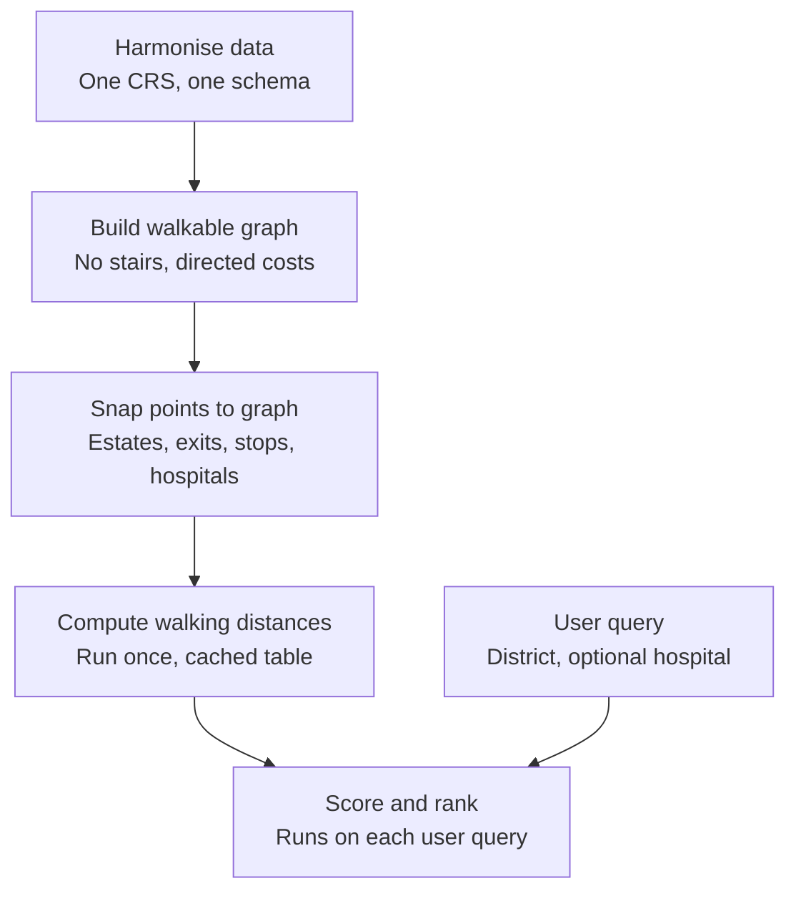

```
Original datasets
│
├── Hospitals [hospital locations and A&E availability]
│   └── facility-hosp.json — JSON
│
├── Estates [estate names, districts, block information and map locations]
│   └── prh-estates (1).json — JSON
│
├── MTR stations [station names, IDs, lines and station order]
│   └── mtr_lines_and_stations.csv — CSV
│
├── MTR accessibility [station facilities and descriptions of accessible exits]
│   ├── barrier_free_facilities.csv — CSV
│   └── barrier_free_facility_category.csv — CSV
│
├── MTR exit coordinates [named entrances, coordinates and access categories]
│   └── data/official_igeocom/
│       ├── source_csv.zip — ZIP containing the official iGeoCom CSV
│       ├── source_geojson.zip — ZIP containing the official iGeoCom GeoJSON
│       └── data_dictionary_v5.pdf — PDF explaining fields and access categories
│
├── Terrain [elevation and broad terrain analysis]
│   └── Whole_HK_DTM_5m.zip — ZIP containing an ASCII terrain grid (.asc)
│
├── Pedestrian network [paths, stairs, ramps, lifts, barriers and access schedules]
|    ├── 3D_Pedestrian_Network_FGDB.zip — ZIP containing a File Geodatabase (.gdb)
|    └── portal.csdi.gov.hk_csdi-webpage_metadata_landsd_rcd_1637222018065_52265_html.pdf
|        — PDF containing network metadata
├── Bus stops [stop coordinates, names, IDs, routes and service directions]
│   └── JSON_BUS.json — GeoJSON stored in a .json file
```
Okay, so I have this data that I've collected for a ranking algorithm that I would like to create.
The algorithm initially lets the user choose one of the four districts that the Hong Kong Housing Authority uses to categorize applicants, and optionally a preferred hospital in Hong Kong. Then it ranks housing estates in that district based on the distance between the estate coordinates and two kinds of locations: the user's hospital, and public transport stations (MTR and/or bus stations). If the user entered no preferred hospital, then rank them based on distance to any public hospital. The distance to these locations should be measured along the pedestrian paths, ramps, lifts, etc (but NOT along stairs). specified in the 3D_pedestrian_network_FGDB zip file. It should not use mere straight-line distances. If what you told me about map distance calculation is correct, then we'll need to convert the pedestrian network zip file into a weighted graph, and combine it with weighted graph versions of the estate locations, mtr exit locations, bus stop locations, and the hospital locations (which are all stored as coordinates in CSVs, JSONs, or geoJSONs). Note four things: 1. the pedestrian network zip file contains gradients for every path that it has in its database. I would like you to use gradients as the weights in the final combined weighted graph. 2. in the pedestrian network zip file, paths are represented as two or more vertices. around 170,000 paths are represented as more than two vertices, and around 290,000 are represented as just two vertices. 3. the CSVs, JSONs, or geoJSONs might contain different models of hong kong, which may mean they use different base sizes, or resolutions. 4. we may need to homogenize the data because the datasets might have different sizes, resolutions, or models of HK. Now that I’ve told you all of this, I can give you my request. I would like to build a python algorithm that can take in one of those four districts, and an optional preferred hospital, and give a list of ranked housing estates. Can you help me draft the high-level structure of the algorithm, its components, and the functions of each component? Please point out parts of the algorithm where alternative implementations are possible, and explain which one you think is best.

# AI Model Response: Housing estate ranking using walking distance: design outline

## Three refinements to the original plan

- **Points get snapped into the graph. They don't become graphs.** Estates, MTR exits, bus stops and hospitals are attached to the pedestrian graph by a short connector to the nearest walkable path. The pedestrian network is the only real graph.
- **Gradient modifies the weight. It can't be the weight.** If cost were the gradient alone, a flat 2 km path would cost zero. Each edge needs a length term, for example `cost = length × penalty(gradient)`, or walking time from a pace model like Tobler's. Gradient also has a sign (uphill one way, downhill the other), so the graph should be directed.
- **Coordinate systems are a bigger risk than resolution.** Only the DTM is a raster. The vector files have positional precision, not resolution. The real hazards are CRS mismatches (HK1980 Grid vs WGS84, and axis order) and what each point represents (an estate centroid vs a gate).

## Pipeline at a glance



The first four stages run once offline and write a cached table. Only the last stage runs per query. There are only a few hundred estates and a few dozen hospitals, so the full estate-to-target distance table is small, and each query becomes a filter, a score and a sort. Computing on demand is only worth it if users can add their own locations.

## 1. Harmonise data (`ingest.py`, `harmonise.py`)

- `load_network(gdb_path)`: reads the File Geodatabase through GeoPandas (GDAL's OpenFileGDB driver). Unzip it first rather than reading it from inside the ZIP.
- `load_estates()`, `load_hospitals()`, `load_mtr_exits()`, `load_bus_stops()`: each returns a GeoDataFrame with a common schema (`id`, `name`, `geometry`, plus type-specific columns).
- `to_common_crs(gdf, "EPSG:2326")`: reprojects everything. Use `always_xy=True` in pyproj, because HK1980's official axis order is northing/easting and swapped axes are a classic silent bug.
- `link_mtr_tables()`: joins the station list, exit coordinates and barrier-free facility tables. This is likely the messiest step, because it means matching station names and IDs across files.
- `validate()`: bounding-box checks (every point inside Hong Kong), nulls, duplicates.

Two checks matter here. First, confirm the estates file gives the Housing Authority's four categories. If it only has the 18 districts, build the mapping from HA's published list rather than guessing. Second, the 5 m DTM can probably stay mostly unused. It is bare-earth elevation, so it misrepresents footbridges and elevated walkways, and 5 m cells are coarse for narrow footpaths. The network's own gradients are better. The DTM is still useful for sanity checks and for estimating slope on the short connector legs in stage 3.

**Alternative:** work in WGS84 and use haversine for distances. This is fine for lengths, but spatial indexing and snapping in degrees distort. A projected metric CRS is better.

## 2. Build the walkable graph (`graph_build.py`)

- `filter_walkable(gdf)`: drops stairs and makes an explicit decision on escalators and travellators if they exist. They are usable by most people but not by wheelchair users.
- `build_topology(gdf)`: nodes sit at path endpoints. Use the network's own node IDs if the geodatabase has them. Otherwise snap endpoints within a tolerance of about 0.1 m. Intermediate vertices of multi-vertex paths are not nodes; they only contribute to length. If a path ends mid-line on another path (a T-junction), split the longer path there, or the graph will have missing connections.
- `edge_cost(length, gradient, kind)`: returns forward and reverse costs. It needs per-type rules. Lifts have zero horizontal length, so slope is undefined and they need a fixed time cost. Barriers and scheduled facilities need a policy, such as assuming they are open at a configurable reference time and flagging routes that depend on them.
- `keep_components(graph)`: reports disconnected pieces and keeps the usable ones.

**Cost function alternatives:** (A) a hard gradient cap only, (B) length × a slope multiplier, (C) walking time from a pace model such as Tobler's. Recommended: C, storing `length_m` separately so you can still report physical distance. If the use case is wheelchair or mobility-aid users, add a hard cap as well, since a steep slope can be impassable rather than just slow.

**The 170k multi-vertex paths:** start with the provided gradient attribute. For multi-vertex paths it is probably an average, which can hide a climb followed by a descent. If the vertices carry Z values, compute the cost per segment and sum it into a single graph edge. That needs no extra nodes, and comparing it with the provided gradient is a good validation check.

## 3. Snap points to the graph (`snapping.py`)

- `snap_points(points, edges)`: finds the nearest edge, the projected position along it, and the snap distance. Use shapely's `STRtree` or `geopandas.sjoin_nearest`.
- `attach(snapped)`: either splits the edge at the projection with a virtual node, or leaves the graph untouched and records `(edge, offset)` so costs to each endpoint are computed from the offset.
- Target-specific rules: only barrier-free MTR exits are valid targets (the stair-free route to an exit is meaningless if the exit itself has stairs). Estates should use block locations if available, taking the minimum or mean across blocks.

Snap only to the stair-free, usable component. Otherwise an estate can land on a stair edge or on an isolated footbridge fragment and get infinite distances. Also set a maximum snap distance (for example 100 m) and flag anything beyond it.

**Alternative:** snap to the nearest node. That is simpler, but the error can reach half an edge length, which is large on long multi-vertex paths. Edge projection is better.

## 4. Compute walking distances (`distances.py`)

- `multi_source_costs(graph, target_nodes)`: one Dijkstra run with all targets as sources gives every node its cost to the nearest target. Run it on the reversed graph so costs reflect walking from the estate to the target, which matters because uphill and downhill costs differ.
- Target sets: all accessible MTR exits, all bus stops, each hospital individually, and all hospitals together.
- Output: a table with one row per estate and columns like `d_mtr`, `d_bus`, `d_hosp_<id>`, `d_hosp_any`, saved to Parquet. Report physical length along the cost-optimal path by tracing the predecessor array.

Don't clip the graph to the chosen district. The nearest exit or hospital may be across a boundary.

**Library alternatives:**

- NetworkX is readable but slower.
- `scipy.sparse.csgraph.dijkstra(min_only=True)` is fast and handles multi-source directly.
- igraph is similar in speed to SciPy.
- pandana is built for nearest-point-of-interest queries on pedestrian networks, but it is a heavier dependency.

Recommended: SciPy for the computation, NetworkX only for debugging.

## 5. Score and rank (`scoring.py`, `query.py`)

`rank_estates(district, hospital=None, modes=("mtr", "bus"), weights=...)` does the following:

1. Filters estates to the district.
2. Picks the hospital column (the chosen hospital, or nearest-any).
3. Scores transit by mode.
4. Normalises and combines the scores.
5. Sorts and returns each estate with its underlying distances and flags.

Decisions here:

- **Combining MTR and bus:** don't take `min(d_mtr, d_bus)`. Bus stops are far denser, so the minimum will almost always be the bus stop and MTR proximity disappears from the ranking. Score each mode separately, then combine.
- **Normalisation:** recommended is capped distance-decay scoring (full score within a short walk, falling to zero at a cutoff). The alternatives are min-max, which is sensitive to outliers, and percentile rank, which is robust but purely relative.
- **Combining criteria:** a weighted sum with exposed weights is transparent and is the recommended choice. Pareto ranking needs no weights but doesn't produce one clean list. Lexicographic ordering (hospital first, then transit) is simple but ignores trade-offs.
- **Unreachable estates:** give them the worst score and a visible flag rather than infinity or silent exclusion.
- **No hospital chosen:** the dataset has A&E availability, so "any hospital" could be restricted to A&E hospitals. Decide which is intended.

## Where to start

Before writing any of this, run a connectivity check on the stair-free graph and read the metadata PDF for field names, gradient units and sign, and whether a node layer exists. Two risks could change the design:

1. The network may not be continuous across the territory, so some estate-to-hospital walks may be unreachable.
2. Walking distance to a hospital several kilometres away may be a weak metric even where a path exists.

If either shows up, hospital proximity may need a fallback such as a capped distance or a road-based measure, while transit proximity stays walking-based.
